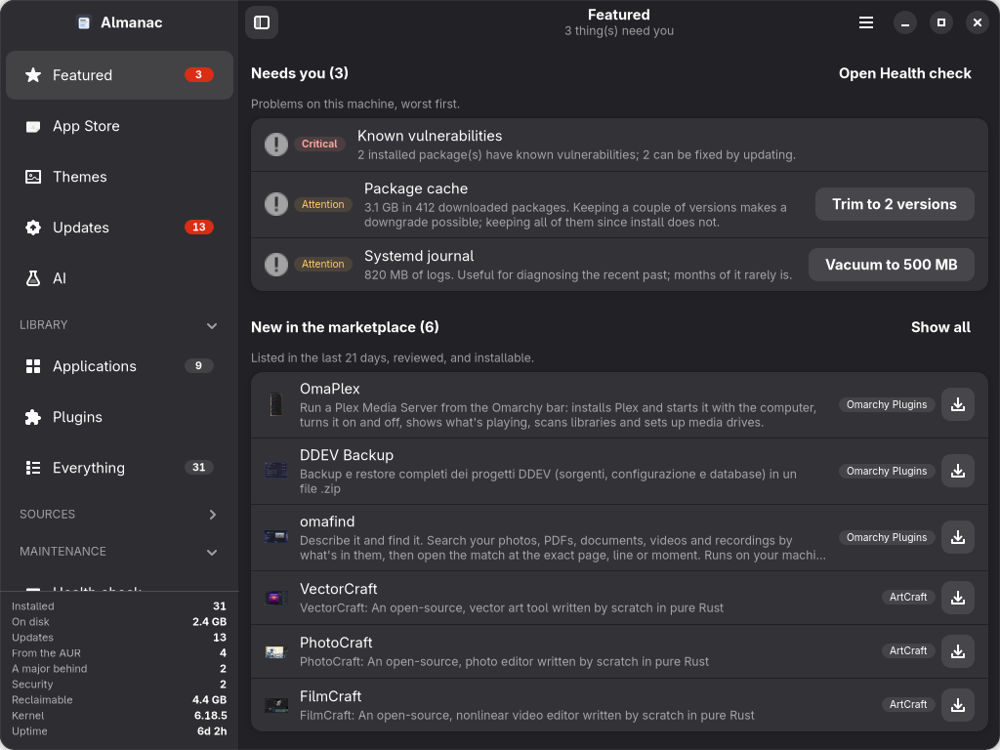
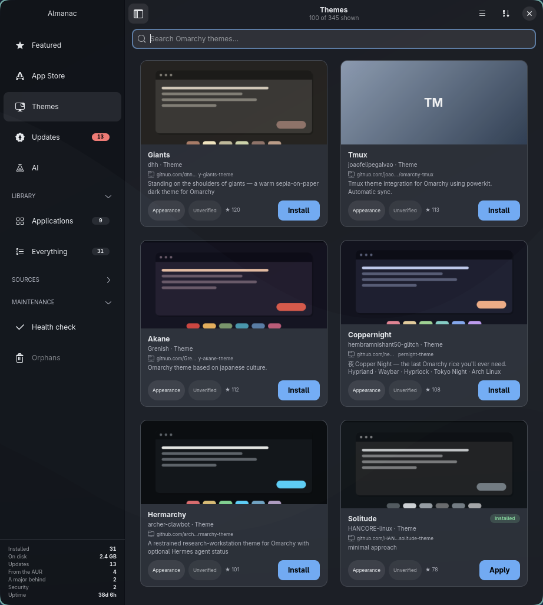
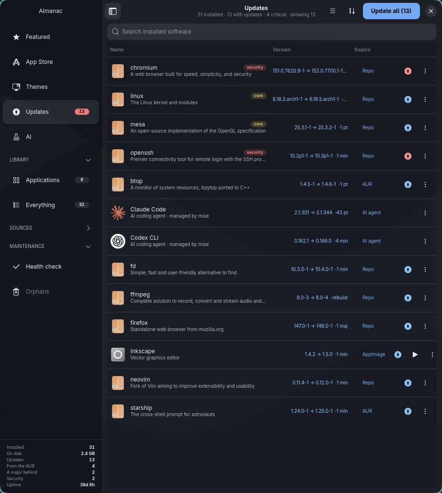
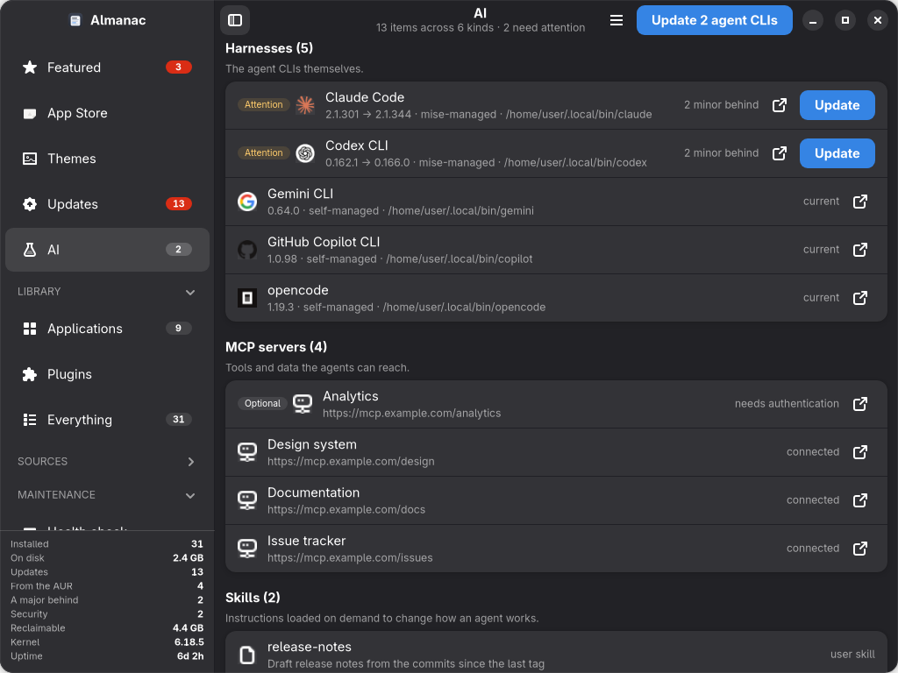
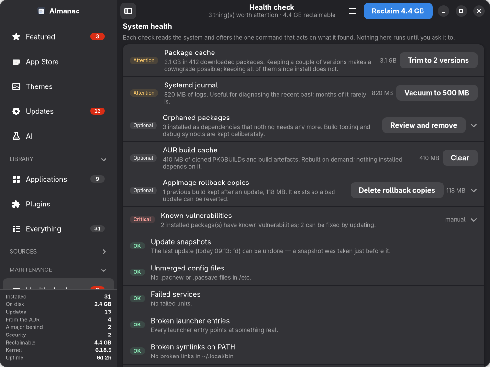

<div align="center">

# Almanac

**Everything installed on this machine — where it came from, how old it is,
whether anyone still maintains it, and what needs you today.**

A native GTK4 / libadwaita catalogue for [Omarchy](https://omarchy.org) and Arch.

[](LICENSE)




</div>

---

## Why

`pacman` knows about packages. It does not know about the AppImage in
`~/.local/share`, the plugin you cloned from a GitHub comment, the Claude Code
binary `mise` installed last week, the MCP server that stopped authenticating,
or the 4.5 GB of package cache you have been carrying since install.

Those live in six different places with six different update mechanisms and no
single thing that looks at all of them. Almanac is that thing.

It is also opinionated about one thing in particular: **provenance**. Before
you install something from a marketplace, Almanac tells you the repository the
code actually comes from — which is not the same as the author name in its
manifest — and whether what you are about to install is still the commit that
was reviewed.

---

## What it does

### Featured — what needs you today


The landing page, assembled from live data rather than an editorial list that
someone has to keep writing:

| Shelf | What it is |
|---|---|
| **Needs you** | Security updates, failed services, caches worth clearing, AUR packages that lost their maintainer. Worst first. Empty is the good outcome. |
| **New in the marketplace** | Listed in the last three weeks, filtered to what is reviewed *and* installable — "new" plus "unverified" is the worst thing to put in front of someone. |
| **Trending** | Worked on in the last week, ranked by stars, capped so no single marketplace can own the shelf. |
| **Because of what you run** | A set intersection over the tags you already have most of. No model, no profile, nothing leaves the machine. |

The hero is your own Omarchy wallpaper, so it re-skins with your theme and
downloads nothing.

### App Store — plugins, apps and themes, with provenance


Three catalogues in one grid, each entry carrying where it actually came from:

- **[Omarchy Plugins](https://plugins.omarchy.org)** — the official marketplace,
  read from the same `catalog.json` the website's own front end uses, so the
  cards here carry the real artwork, descriptions, stars and install commands.
- **Omarchy Themes** — 345 community themes from the `omarchy-theme` topic,
  with its own sidebar entry. Install clones it; applying it is a separate,
  explicit second step, because nobody wants their whole desktop re-skinned by
  a curious click.
- **[ArtCraft](https://getartcraft.com)** — the Craft apps, installed as
  AppImages and tracked for updates afterwards.

Every card shows a **provenance chip**:

| Chip | Meaning |
|---|---|
| `Official` | Ships with Omarchy itself |
| `First-party` | Published by the marketplace's own GitHub account — *checked*, not assumed |
| `Reviewed` | A human reviewed the source |
| `Verified` | Automated checks passed against the listed commit |
| `Changed since review` | Upstream has committed past what was reviewed — **1,336 listings are in this state** |
| `Unverified` | No review recorded |
| `Source unreachable` | The marketplace could not reach the repository on its last check |

Sort and filter by provenance, publisher, marketplace, category or stars.

### Themes — what the theme actually looks like



GitHub's social card shows a repository, which tells you nothing about the only
question you have. Every Omarchy theme publishes `colors.toml`, so Almanac
fetches it — from `raw.githubusercontent.com`, which costs no API quota — and
draws a miniature desktop in the theme's own colours: its bar, its window, its
text, its accent, and the palette your terminal will use.

Stock themes that ship with Omarchy are marked `Official` and offer **Apply**;
community ones you installed also offer **Remove**. Same card, same slots, same
vocabulary as every other listing.

### Updates — one list for six package managers



Repo, AUR, Flatpak, AppImage, local git checkouts, AI agent CLIs and Almanac
itself, with versions-behind counts, security flagging, and per-row actions.
Vendor logos are resolved from each package's own upstream URL, which `pacman`
already records.

Install and removal run **inside the app**. Removal still shows you the full
`pacman -Rs` preview, including the dependencies it would take with it, before
anything happens — the confirmation moved somewhere readable, it was not
dropped.

### AI — the estate no package manager tracks



Agent CLIs (Claude Code, Codex, Gemini, opencode, Copilot, Cursor, Crush,
Goose, Aider, Qwen, Amp, Droid), MCP servers with live health, skills, plugins,
marketplaces and hooks — with each vendor's own mark, fetched from that vendor.

How each agent updates is **detected, not assumed**: a `mise`-managed binary
updates through `mise`, one with its own `update` subcommand uses that, and one
with neither says so instead of pretending.

### Health check — what six gigabytes of nothing looks like



Twelve read-only checks, each offering the single command that acts on what it
found: package cache, journal size, AUR build cache, orphans (with build
tooling deliberately kept), unmerged `.pacnew` files, failed services, broken
launcher entries, dead symlinks, AppImage rollback copies, AUR packages that
vanished upstream, trash and disk headroom.

---

## Install

**From the AUR** (recommended — Almanac then appears in its own Updates list
as a package, and defers its updates to `pacman`):

```bash
yay -S almanac-git
```

**From source:**

```bash
git clone https://github.com/twodxme/almanac ~/.local/share/almanac
cd ~/.local/share/almanac
ln -sf "$PWD/almanac" ~/.local/bin/almanac
install -Dm644 docs/almanac.desktop ~/.local/share/applications/almanac.desktop
install -Dm644 docs/io.github.twodxme.Almanac.svg \
  ~/.local/share/icons/hicolor/scalable/apps/io.github.twodxme.Almanac.svg
gtk-update-icon-cache -f -t ~/.local/share/icons/hicolor
```

Then run `almanac`, or launch it from your application menu.

Runtime data lives in `~/.local/state/almanac/`, never inside the checkout, so
Almanac can update itself with a fast-forward pull without fighting its own
state.

### Updating

Almanac appears in its own Updates list. **☰ → Update Almanac…** does a
`git pull --ff-only` and offers to restart. It cannot overwrite local work: if
you have uncommitted changes, the pull refuses and says so rather than creating
a conflict inside a running application.

---

## Requirements

| | |
|---|---|
| **Required** | Python 3.11+, GTK 4, libadwaita 1.9+ |
| **Full experience** | Arch or Omarchy — `pacman`, `yay`, `checkupdates` |
| **Optional** | `omarchy` (plugins, themes, system updates) · `flatpak` · `mise` · `gh` |

`gh` is worth having: Almanac uses your existing `gh auth token` to raise the
GitHub API ceiling from 60 requests an hour to 5,000. It is never written to
disk and never logged.

Almanac degrades rather than breaks. Without `omarchy` you lose the plugin and
theme catalogues; without `flatpak` that source simply does not appear. Nothing
is required for the app to open and be useful.

---

## Theming

Almanac wears whatever Omarchy is wearing. It reads
`~/.local/state/omarchy/current/theme/colors.toml` and restates it as
libadwaita's named colours, so every widget follows — including ones added
later, because nothing is themed individually.

`omarchy theme set <name>` re-skins the window within a frame or two; the theme
is watched, not sampled at startup. On a machine without Omarchy, your GTK
theme shows through unmodified.

---

## Keyboard

| | |
|---|---|
| <kbd>Ctrl</kbd>+<kbd>1</kbd>…<kbd>7</kbd> | Jump to a destination |
| <kbd>Ctrl</kbd>+<kbd>F</kbd> | Search |
| <kbd>Esc</kbd> | Clear search |
| <kbd>Ctrl</kbd>+<kbd>R</kbd> / <kbd>F5</kbd> | Refresh the current page |
| <kbd>Ctrl</kbd>+<kbd>U</kbd> | Update all |
| <kbd>Ctrl</kbd>+<kbd>W</kbd> | Close |

`almanac --page store|updates|ai|health|featured` opens straight to a page,
which makes it scriptable from a keybinding or a bar widget.

---

## What leaves your machine

Stated plainly, because an app that reads your whole system should be explicit
about this:

- **Marketplace catalogues** from `plugins.omarchy.org`, the GitHub API and
  `getartcraft.com`. Cached for six hours.
- **Vendor icons**, fetched from each vendor's own domain — `stripe.com`'s
  favicon comes from `stripe.com`. Deliberately *not* a favicon proxy, which
  would mean sending one request containing the full list of everything you
  have installed to a single third party.
- **GitHub release checks** for AppImages and agent CLIs, conditional on ETags
  so an unchanged release costs no quota.

No analytics, no telemetry, no accounts. Nothing is sent about what you have
installed; icon requests reveal only that *somebody* asked that host for its
favicon.

---

## Contributing

Issues and pull requests are welcome — bug reports, new sources, new health
checks, packaging for other distributions, or a theme that makes it look
better than I can.

```bash
python3 test_app.py
```

28 tests, weighted toward the destructive paths — removal, orphan cleanup,
AppImage replacement — because those are the ones that cannot be undone by
clicking again. If you touch removal, orphan cleanup or install, the tests that
assert *nothing runs before confirmation* must still pass.

There is a measured [UI/UX audit and gap analysis](docs/audit.md) covering the
conventions the interface follows and the gaps still open. New UI should match
what is already there: one primary action in the header, toasts for events, the
header subtitle for standing state, full-width boxed lists on secondary pages.

---

## Credits

Built for [**Omarchy**](https://omarchy.org), [DHH](https://github.com/dhh)'s
opinionated Arch + Hyprland distribution. Almanac exists because Omarchy made a
desktop worth curating — and because a system that good deserves to know what
is on it. The `omarchy` CLI does the real work behind every plugin, theme and
system action here; this is a window onto it.

- [Omarchy Plugin Marketplace](https://github.com/omacom/omarchy-plugin-marketplace)
  for the catalogue, the verification pipeline, and for publishing it in a form
  anyone can read.
- [ArtCraft](https://getartcraft.com) for the Craft apps.
- Every theme author in the `omarchy-theme` topic.

## License

[MIT](LICENSE).
