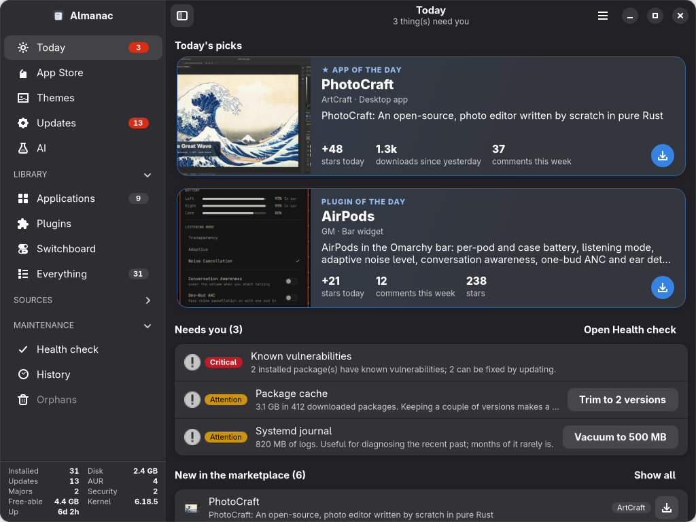
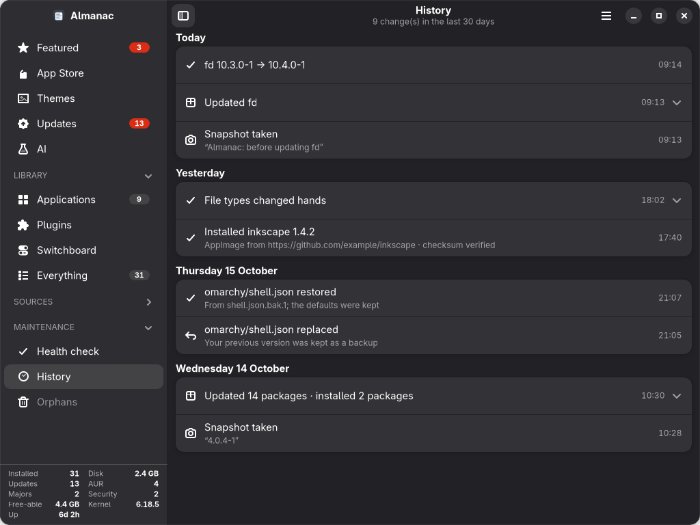
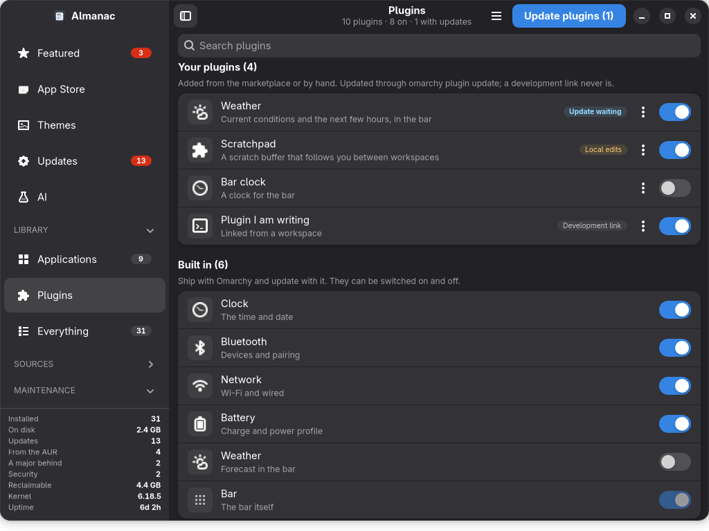
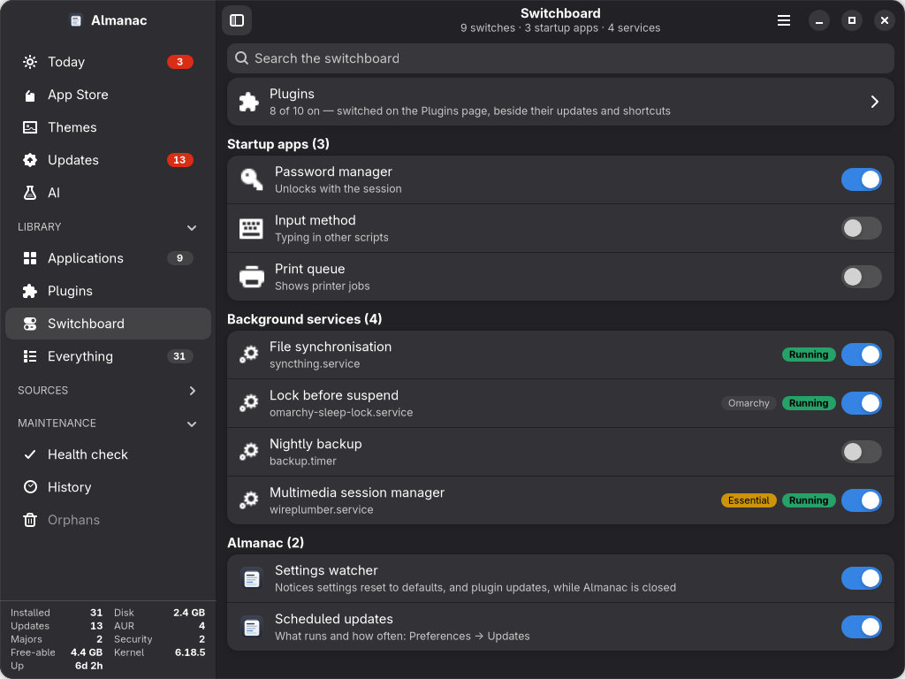

<div align="center">


# Almanac

**Everything installed on this machine — where it came from, how old it is,
whether anyone still maintains it, and what needs you today.**

A native GTK4 / libadwaita catalogue for [Omarchy](https://omarchy.org) and Arch.

[](https://github.com/twodxme/almanac/actions/workflows/ci.yml)
[](LICENSE)




</div>

> **Almanac 2.0 is written in Rust.** Same app, same look, same files on
> disk: it was ported line for line from the 1.x Python app and held to it
> case by case until the two matched. Settings, history and caches from 1.x
> carry over untouched.

## Install

Almanac runs on **Arch Linux and Omarchy** (x86_64). Open a terminal and run:

```bash
curl -LO https://github.com/twodxme/almanac/releases/latest/download/almanac-x86_64.pkg.tar.zst
sudo pacman -U almanac-x86_64.pkg.tar.zst
```

That is all: `pacman` installs everything Almanac needs along with it. Open
**Almanac** from your app launcher, or run `almanac`.

To update to a newer release, run the same two commands again. To remove it:
`sudo pacman -R almanac`.

Building it yourself, other architectures, and running from a checkout are
[below](#building-it-yourself).

---

## Why

`pacman` knows about packages. It does not know about the AppImage in
`~/.local/share`, the plugin you cloned from a GitHub comment, the Claude Code
binary `mise` installed last week, the MCP server that stopped authenticating,
or the gigabytes of package cache you have been carrying since install.

Those live in six different places with six different update mechanisms and no
single thing that looks at all of them. Almanac is that thing.

It is also opinionated about one thing in particular: **provenance**. Before
you install something from a marketplace, Almanac tells you the repository the
code actually comes from — which is not the same as the author name in its
manifest — and whether what you are about to install is still the commit that
was reviewed.

---

## What it does

### Today — what needs you, and what's new


The landing page, assembled from live data rather than an editorial list that
someone has to keep writing:

| Shelf | What it is |
|---|---|
| **Today's picks** | The one or two standouts of the day: an app and a plugin, on wide cards that look nothing like the store's. Ranked on GitHub's own figures — stars and forks in the last 24 hours, downloads, comments this week — with each signal judged within its marketplace, so a 60-star plugin is not drowned out by a 15,000-star app. Each number says exactly what it counts: "stars in 10h" when the event feed reaches back only ten hours, "downloads of v0.8.0" until a day-over-day figure exists. Picks hold for the day and yesterday's make room for someone else. |
| **Needs you** | Security updates, failed services, caches worth clearing, AUR packages that lost their maintainer. Worst first. Empty is the good outcome. |
| **New in the marketplace** | Listed in the last three weeks, filtered to what is reviewed *and* installable — "new" plus "unverified" is the worst thing to put in front of someone. |
| **Trending** | Worked on in the last week, ranked by stars, capped so no single marketplace can own the shelf. |
| **Because of what you run** | A set intersection over the tags you already have most of. No model, no profile, nothing leaves the machine. |

The hero is your own Omarchy wallpaper, so it re-skins with your theme and
downloads nothing.

### App Store — plugins and apps, with provenance


Two catalogues in one grid, each entry carrying where it actually came from:

- **[Omarchy Plugins](https://plugins.omarchy.org)** — the official marketplace,
  read from the same `catalog.json` the website's own front end uses, so the
  cards here carry the real artwork, descriptions, stars and install commands.
- **[ArtCraft](https://getartcraft.com)** — the Craft apps, installed as
  AppImages and tracked for updates afterwards.

Themes are not listed here: they have their own page, below.

Every card shows a **provenance chip**:

| Chip | Meaning |
|---|---|
| `Official` | Ships with Omarchy itself |
| `First-party` | Published by the marketplace's own GitHub account — *checked*, not assumed |
| `Reviewed` | A human reviewed the source |
| `Verified` | Automated checks passed against the listed commit |
| `Changed since review` | Upstream has committed past what a person reviewed |
| `Changed since check` | Upstream has committed past what the automated checks passed |
| `Unverified` | No review recorded |
| `Source unreachable` | The marketplace could not reach the repository on its last check |

Sort and filter by provenance, publisher, marketplace, category or stars.

### Themes — what the theme actually looks like

345 community themes from the `omarchy-theme` topic, on their own page.
Install clones a theme; applying it is a separate, explicit second step,
because nobody wants their whole desktop re-skinned by a curious click.


GitHub's social card shows a repository, which tells you nothing about the only
question you have. Every Omarchy theme publishes `colors.toml`, so Almanac
fetches it — from `raw.githubusercontent.com`, which costs no API quota — and
draws a miniature desktop in the theme's own colours: its bar, its window, its
text, its accent, and the palette your terminal will use.

Stock themes that ship with Omarchy are marked `Official` and offer **Apply**;
community ones you installed also offer **Remove**. Same card, same slots, same
vocabulary as every other listing.

### Updates — one list for everything that updates


Repo, AUR, Flatpak, AppImage, local git checkouts, version-managed developer
tools, AI agent CLIs and Almanac itself — with versions-behind counts, security
flagging, and per-row actions. Vendor logos are resolved from each package's own
upstream URL, which `pacman` already records.

| Source | Where it comes from | Updated with |
|---|---|---|
| Repositories | `pacman` + `checkupdates` | `pacman` |
| AUR | `yay -Qua` | `yay`, building locally |
| Omarchy | the `omarchy` packages themselves | `omarchy update` |
| Flatpak | `flatpak` | `flatpak` |
| AppImages | the `.upd_info` each AppImage embeds | downloaded in place, old build kept |
| Local builds | git checkouts under `~/.config/omarchy/plugins` | `git pull --ff-only` |
| Dev tools | `mise ls` — `gh`, `uv`, `node` and friends | `mise upgrade` |
| AI agents | `mise`, or each agent's own updater | whichever owns it |
| Almanac | its own checkout, or GitHub's latest release for a package | `git pull --ff-only`, or the release's package |

How a thing updates is **detected, not assumed**. A shimmed `mise` binary
resolves to `/usr/bin/mise`, which looks nothing like a mise install path — so
asking the filesystem gets it wrong, and asking `mise` gets it right.

**What you just updated leaves the list on the next scan.** Only the upstream
side of a check is cached — `mise outdated`, `git fetch`, GitHub releases —
because that is the part that costs a network round trip. What is installed is
read live every time: `mise ls` takes milliseconds, and a commit count against
already-fetched refs never touches the network. **Update all** rescans by
itself when its terminal closes.

A repository update can be visible before it is installable. `checkupdates`
syncs a private copy of the package database, so it sees releases the system
copy has not heard of yet; installing one of those on its own would mean
`pacman -Sy` for a single package, the partial upgrade Arch warns against.
For those rows, **Update** says so and offers **Update all** instead of running
a command that would skip the package and report success.

**A jump in the count is explained, not just shown.** Omarchy takes the Arch
repositories from a stable mirror that holds packages back and releases them
in tested batches, so the count can go from 5 to 370 overnight with nothing
wrong. When it does, a note above the list says so — *Omarchy released a new
batch of Arch packages on 17 Oct … this machine's last batch is from 8 Sep, so
these 370 updates are 6 weeks of Arch arriving together.* Both dates come from
disk, not the network: pacman's sync database and `checkupdates`' private copy
each carry the mirror's Last-Modified time. On an ordinary mirror the note says
when the package lists were last synced instead; under a week's gap it says
nothing. When the batch includes the kernel, systemd, glibc, graphics drivers
or firmware, a second note says to restart afterwards and names them.

Versions-behind counts from the first component that actually differs, and
calendar versions are not counted at all: `20181225 → 20261002` is a date, not
79,777 releases.

Install and removal run **inside the app**. Removal still shows you the full
`pacman -Rs` preview, including the dependencies it would take with it, before
anything happens — the confirmation moved somewhere readable, it was not
dropped.

### AI — the estate no package manager tracks


Agent CLIs (Claude Code, Codex, Gemini, opencode, Copilot, Cursor, Crush,
Goose, Aider, Qwen, Amp, Droid), MCP servers with live health, skills, plugins,
marketplaces and hooks — with each vendor's own mark, fetched from that vendor.

How each agent updates is **detected, not assumed**: a `mise`-managed binary
updates through `mise`, one with its own `update` subcommand uses that, and one
with neither says so instead of pretending.

### Health check — what six gigabytes of nothing looks like


Seventeen read-only checks, each offering the single command that acts on what it
found: package cache, journal size, AUR build cache, orphans (with build
tooling deliberately kept), unmerged `.pacnew` files, failed services, broken
launcher entries, dead symlinks, AppImage rollback copies, AUR packages that
vanished upstream, package file integrity, session logs, trash, disk
headroom, settings reset to defaults, known vulnerabilities, and whether the
last update can be undone.

A cleanup is judged by what it would free, not by how big the thing is. A
trimmed package cache is still gigabytes — two versions of everything
installed is what makes a downgrade possible — so it is rated on paccache's own
dry run, and clears once there is nothing left to trim.

---

## What it watches for

### Known vulnerabilities, not guesses

A "security update" is one that fixes a known vulnerability in the version you
have installed — matched against the [Arch Security
Tracker](https://security.archlinux.org) with pacman's own `vercmp`. Each
package's page lists its advisories, with severity, CVEs and the fixed
version, and the Health check says which can be fixed by updating and which
have no fix released yet. When the tracker cannot be reached, Almanac says so
rather than reporting a clean bill.

### History — what changed, and when



"It worked last week" starts most troubleshooting. History puts the last 30
days on one timeline: every package transaction, every snapshot, every config
file a tool replaced, and everything Almanac itself did — including updates
that ran but changed nothing. Days with a snapshot say so, since what came
after can be undone from the boot menu.

The page opens with one line for the last 24 hours — *Installed lld and rust ·
the scheduled update updated vectorcraft and wordcraft* — so "did something
install last night?" is answered before you read the timeline. The weekly
scheduled update records what it updated there too.

### Every action is checked, not assumed

An exit status says a command ran, not that it did what was asked. `yay -S
--needed` skips a package the system database does not know is newer;
`journalctl --vacuum-size` deletes nothing without root; `paccache` can have
nothing left to trim. Each exits 0. So every update, install and cleanup is
bracketed by the same question asked before and after — *which version is
installed? what does this check find?* — and you are told the difference.
"The update ran, but 26.04.5 is still installed" is a result, and it is shown
as one.

### Settings put back to their defaults

Some repair commands replace a config file with the shipped default and keep
yours as `<file>.bak.<time>` — without saying so. Almanac recognises that from
the files alone (the file now matches the default, the backup does not),
notices it the moment it happens, says what was lost ("9 bar widgets
removed"), and restores your version in one click. The defaults it replaces
are kept, so the restore can be undone too. With the window closed, an
optional background watcher (Preferences → *While Almanac is closed*) does the
same: a few directory monitors and no window, started through XDG autostart.

### Updates you can undo

On systems with [Snapper](http://snapper.io), every package Almanac installs
or updates is snapshotted first, and the Health check says whether your last
update — however it was run — can be rolled back. Booted into a snapshot from
the boot menu, it offers to make that snapshot permanent. Snapshot listings
are root-only, so this is read from pacman's log and the system journal
rather than from the snapshots themselves.

### Files an install took over

Installing an app can quietly make it what opens your `.docx` or `.pdf`
files. Almanac reads every file type's default app before and after each
install, and if anything changed hands it says so — *"WordCraft now opens
.docx, .odt — before: LibreOffice Writer"* — and can give them back, through
the standard `xdg-mime`.

### Install from a link

Paste a GitHub link (☰ → Install from a link, or straight into the search
box). Almanac lays out every way the project reaches your machine — the
official repositories, the project's own AppImage, AUR packages that build
from source or repackage a binary — and recommends one, with the reasons and
the caveats. An AppImage is checked against the SHA-256 GitHub publishes for
it before it is made runnable; an AUR package whose upstream is a different
project is flagged.

### Plugins that need setup

The marketplace marks about a thousand plugins "manual setup" because their
README asks for more than the install — an API key, a package, a build step.
Almanac installs them like any other (`omarchy plugin add`, validated by
Omarchy), says up front that setup follows, and then reads the README from the
installed copy: packages it installs for you, build steps and setup scripts it
shows — the file a line names to run, in full, and the build files a build tool
opens (`Makefile`, `package.json`'s scripts, `pyproject.toml`, `Cargo.toml`,
`go.mod` …) — and runs in a terminal you can watch, stopping if a file shown
has changed (or a symlink to it now points elsewhere) or a build file that was
absent has appeared. A line is offered only when the shell would read it as
plain words (no variables, globs, `;`, pipes, redirections or `cd`), and each
step runs as exactly those words. The checks are made as each step starts:
something an earlier step left running in the background is not watched.
What those files go on to run (a recipe's script, a postinstall, the sources a
build compiles) is not shown, and the confirmation says so for every build.
Anything only you can do — credentials, config edits — it lists with the
section to read. Only
install, setup and configuration sections are read; development, testing and
uninstall instructions are never offered. Plugins whose install itself cannot
be done safely (a failed compatibility check, a version-matched helper, a
monorepo, a suite with its own installer) still say "Manual setup", and why.

### Plugins — every one on the system, with a switch



Library → Plugins lists every plugin Omarchy knows about, yours first and the
built-ins after, each with a switch (`omarchy plugin enable/disable`) that
moves only once Omarchy agrees. Each carries a logo — the vendor's own for a
plugin about a service, the marketplace artwork for a listed one, otherwise an
icon for what it does — and, for yours, its update state and provenance.
Before anything offers to update one, it is classified: up to date, update
waiting, local changes (edited, ahead of upstream, diverged, detached), local,
or error. A **symlinked development plugin** — a link to its author's workspace —
is never updated here, though `omarchy plugin update` would fast-forward it.
Updates go through `omarchy plugin update`, which validates the result and
rolls back a plugin that fails.

**☰ → Update plugins** updates every clean pending update at once, within a
scope set in Preferences — verified only, verified and changed since review,
or all — and lists what it held back and why. *Verified* means the plugin you
have: its checkout must come from the repository the marketplace lists, and
upstream must still be at the commit that was checked — a fork under the same
name, or a push made after the check, is held. Scheduled runs honour the same
scope, and each plugin is checked again at the moment it is updated. A plugin
with a panel can be given a **keyboard shortcut**: checked against every
binding Hyprland has, written to its own block in `bindings.lua`, put back if
Hyprland rejects it, and removed with the plugin. **☰ → Restart the
shell** restarts it and clears the compiled QML cache, for a plugin that acts
as if it had not been updated.

### Switchboard — everything with an on/off, in one place



The apps that start when you log in, your session's background services, and
Almanac's own background work — each with a switch, switched the standard
way: a per-user `Hidden=true` override in `~/.config/autostart` (the system's
copy is never touched) and `systemctl --user enable/disable --now`. Plugins
are switched on the Plugins page, beside their updates and shortcuts; the
Switchboard shows how many are on and links there. Every switch moves only
once the change holds. Session plumbing — PipeWire, the portals, the keyring —
is marked essential and asks first, saying what would stop working; services
started on demand by something else are not offered, since their switch could
not mean what it says.

### Major releases and local changes

A new major version of an agent CLI is held back from "update all" and from
scheduled runs, and shown with its release notes when you update it on its
own. A plugin or checkout you have patched is weighed against the update
before pulling: if the update already contains your change it is dropped, if
it still applies it is carried forward, and if the update rewrote the same
lines your change is set aside as a git stash — never discarded.

---

## Building it yourself

**As a package** — what the download above is, built on your own machine
from the newest commit (also the way to get Almanac on aarch64):

```bash
sudo pacman -S --needed base-devel git rust
git clone https://github.com/twodxme/almanac
cd almanac
makepkg -si
```

The build takes a few minutes and runs the test suite. If you use `rustup`
instead of the `rust` package, skip `rust` above and run
`rustup default stable` once first.

**From a checkout**, for working on Almanac itself (needs `cargo`). The app
finds its icons in the checkout, so keep it where you cloned it:

```bash
git clone https://github.com/twodxme/almanac ~/.local/share/almanac
cd ~/.local/share/almanac
cargo build --release
install -Dm755 target/release/almanac ~/.local/bin/almanac
install -Dm755 target/release/almanac-autorun ~/.local/lib/almanac/almanac-autorun
install -Dm644 docs/almanac.desktop ~/.local/share/applications/almanac.desktop
install -Dm644 docs/io.github.twodxme.Almanac.svg \
  ~/.local/share/icons/hicolor/scalable/apps/io.github.twodxme.Almanac.svg
gtk-update-icon-cache -f -t ~/.local/share/icons/hicolor
```

Runtime data lives in `~/.local/state/almanac/`, never inside the checkout, so
a checkout can be pulled and rebuilt without fighting its own state.

### Updating

Installed from the download above, update by running the same two commands
again; Almanac's own row says when a newer release is out and links to it. A package built with `makepkg` updates by pulling and running
`makepkg -si` again in the clone. A build from a checkout cannot
replace itself while it runs, so it says so and tells you to pull and run
`cargo build --release` instead.

---

## Requirements

| | |
|---|---|
| **Required** | GTK 4, libadwaita 1.9+, OpenSSL (building it: `cargo`, Rust 1.92+) |
| **Full experience** | Arch or Omarchy — `pacman`, `yay`, `checkupdates` |
| **Optional** | `omarchy` (plugins, themes, system updates) · `flatpak` · `mise` · `gh` · `snapper` (undoable updates) · `xdg-utils` · `xdg-terminal-exec` |

`gh` is worth having: Almanac uses your existing `gh auth token` to raise the
GitHub API ceiling from 60 requests an hour to 5,000. It is sent only to
`api.github.com` — never along a redirect to another host, never over plain
http — and never written to disk or logged.

Almanac degrades rather than breaks. Without `omarchy` you lose the plugin and
theme catalogues, and full upgrades run through `yay`, `paru` or `pacman`
instead; without `flatpak` that source simply does not appear; without
`snapper` updates are not snapshotted. Nothing is required for the app to open
and be useful.

It follows the desktop's conventions rather than assuming one desktop: base
directories come from the XDG Base Directory variables, a terminal is opened
with `xdg-terminal-exec` (or `$TERMINAL`, or whichever known terminal is
installed), file-type choices go through `xdg-mime`, and anything needing root
asks through polkit.

---

## Preferences

**☰ → Preferences** (Ctrl+,) has four pages:

- **General** — which page Almanac opens on, and which desktop notifications
  you want: an action that changed nothing, settings reset to defaults,
  plugin updates available.
- **Updates** — the scheduled update and what it includes, whether major
  releases wait for you, and which plugins bulk updates may touch.
- **Privacy** — a switch for everything Almanac fetches: each marketplace, the
  Arch Security Tracker, logos, and using your `gh` sign-in. Switch one off and
  that part of Almanac does without.
- **Background** — the settings watcher, which also checks plugins for updates
  every few hours and notifies you only when something new is waiting.

## Theming

Almanac wears whatever Omarchy is wearing. It reads
`~/.local/state/omarchy/current/theme/colors.toml` and restates it as
libadwaita's named colours, so every widget follows — including ones added
later, because nothing is themed individually.

`omarchy theme set <name>` re-skins the window within a frame or two; the theme
is watched, not sampled at startup. On a machine without Omarchy, your GTK
theme shows through unmodified.

Text is measured, not trusted to the theme. Primary text is held to 7:1
(WCAG AAA) on the lightest surface it is drawn on, secondary text and
accent-coloured text to 5.5:1, and status pills are solid fills with whichever
text reads best on each. A theme that already clears those is left exactly as
it is; one that does not (Everforest's dimmed captions measured 3.1:1 on a
card) is lifted only as far as it needs to go.

---

## Keyboard

| | |
|---|---|
| <kbd>Ctrl</kbd>+<kbd>1</kbd>…<kbd>7</kbd> | Jump to a destination |
| <kbd>Ctrl</kbd>+<kbd>F</kbd> | Search |
| <kbd>Esc</kbd> | Clear search |
| <kbd>Ctrl</kbd>+<kbd>R</kbd> / <kbd>F5</kbd> | Refresh the current page |
| <kbd>Ctrl</kbd>+<kbd>U</kbd> | Update all |
| <kbd>Ctrl</kbd>+<kbd>W</kbd> | Close |

`almanac --page today|store|updates|ai|health|history|plugins|switchboard`
opens straight to a page, which makes it scriptable from a keybinding or a bar
widget.

For an update script, `almanac-autorun --core-holds --stdin` reads pending
updates as `checkupdates` and `yay -Qua` print them (`name old -> new`) and
prints the ones Almanac counts as core — every kernel flavour and its headers
(linux, -lts, -zen, -hardened, -rt, cachyos, xanmod, ...), boot, firmware,
CPU microcode, DKMS modules and the NVIDIA driver with its matching
userspace — one per line, so the script can hold exactly what the Updates page
marks. When it cannot tell, it exits non-zero rather than printing nothing, so
a script holds instead of guessing.

---

## What leaves your machine

Stated plainly, because an app that reads your whole system should be explicit
about this:

- **Marketplace catalogues** from `plugins.omarchy.org`, the GitHub API and
  `getartcraft.com`. Cached for six hours — or ten minutes, when GitHub did not
  answer for some entry, which is listed as *Not checked* rather than
  guessed at.
- **Vendor icons**, fetched from each vendor's own domain — `stripe.com`'s
  favicon comes from `stripe.com`. Deliberately *not* a favicon proxy, which
  would mean sending one request containing the full list of everything you
  have installed to a single third party.
- **GitHub release checks** for AppImages and agent CLIs, conditional on ETags
  so an unchanged release costs no quota.
- **Today's picks**: for a shortlist of about ten listings (four without a
  GitHub sign-in), each repository's public event feed, its latest release and
  its last week of issue comments, from the GitHub API. Cached for hours, so
  this is a handful of requests a day.
- **The Arch Security Tracker's advisory list**, downloaded whole and matched
  against your packages locally. Cached for six hours.
- **Install from a link**: the repository and its latest release from the
  GitHub API, and the matching package names from the AUR's public API —
  only for the link you pasted, only when you ask.

Each of these can be switched off in **Preferences → Privacy**. No analytics,
no telemetry, no accounts. Nothing is sent about what you have
installed; icon requests reveal only that *somebody* asked that host for its
favicon.

---

## Contributing

Issues and pull requests are welcome — bug reports, new sources, new health
checks, packaging for other distributions, or a theme that makes it look
better than I can.

```bash
cargo test
```

518 tests, weighted toward the destructive paths — removal, orphan cleanup,
AppImage replacement — because those are the ones that cannot be undone by
clicking again. If you touch removal, orphan cleanup or install, the tests that
assert *nothing runs before confirmation* must still pass.

### Translating

Interface text is marked for GNU gettext and collected in
[`po/almanac.pot`](po/almanac.pot). To add a language:

```bash
msginit -i po/almanac.pot -o po/<lang>.po -l <lang>   # e.g. de, pt_BR
# translate po/<lang>.po, then:
po/update.sh                                            # merges and compiles
```

Run from a checkout, Almanac picks up `./locale` straight away; the package
build installs every `po/*.po` into the system locale directory. The window,
menus, dialogs and Health check headings are translatable today; sentences
built around a value (versions, counts, names) are still being converted, and
pull requests that rewrite them as whole translatable sentences are welcome.

How the code is laid out, and the conventions it follows, are in
[ARCHITECTURE.md](ARCHITECTURE.md). New UI should match what is already there: one primary action in the header, toasts for events, the
header subtitle for standing state, full-width boxed lists on secondary pages.

---

## Credits

Built for [**Omarchy**](https://omarchy.org), [DHH](https://github.com/dhh)'s
opinionated Arch + Hyprland distribution. Almanac exists because Omarchy made a
desktop worth curating — and because a system that good deserves to know what
is on it. The `omarchy` CLI does the real work behind every plugin, theme and
system action here; this is a window onto it.

- [Omarchy Plugin Marketplace](https://github.com/omacom/omarchy-plugin-marketplace)
  for the catalogue, the verification pipeline, and for publishing it in a form
  anyone can read.
- [ArtCraft](https://getartcraft.com) for the Craft apps.
- [omaplug](https://github.com/fross100/omaplug) by Fross, whose plugin
  states, scoped bulk updates and conflict-checked shortcuts Almanac's
  installed-plugin management follows.
- Every theme author in the `omarchy-theme` topic.

## License

[MIT](LICENSE).

---

## Screenshots

Every screenshot in this README is generated with `ALMANAC_DEMO=1`, which
replaces the local inventory with the fixtures in `src/demo.rs`. The marketplace
catalogues stay real — those are public listings — but nothing in an image
comes from the machine that took it.

```bash
ALMANAC_DEMO=1 almanac --page featured
```
